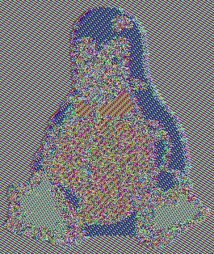

# 06-Block-Cipher-Modes
---

## 1. Geração de chave compartilhada

```bash
$ openssl enc -pbkdf2 -aes-128-ecb -k my-secret-passphrase -P
salt=173A5C72D61C698F
key=B0D6C118DD552E472C178FBC4280DB04

$ echo B0D6C118DD552E472C178FBC4280DB04 > key.priv
```

O PBKDF2 deriva uma chave de 128 bits a partir da passphrase + salt aleatório.
O salt garante que a mesma senha gere chaves diferentes a cada execução,
prevenindo ataques de dicionário. A chave é salva em `key.priv`.

---

## 2. Cifragem e decifragem de texto plano

```bash
# Cifrar
$ openssl enc -aes-128-ecb -in cleartext.txt -K $(cat key.priv) -out ciphertext.txt

# Verificar que o conteúdo é ilegível
$ xxd ciphertext.txt | head -3
00000000: 591f aef4 cbbf 6130 f38d 597e 100d f1f6  Y.....a0..Y~....
00000010: d522 3117 aacb 969b 9e58 bb77 4355 6cb5  ."1......X.wCUl.
00000020: 2a4c ff35 e7b7 8b76 9a12 8d22 9414 ee91  *L.5...v..."....

# Decifrar - recupera o texto original
$ openssl enc -d -aes-128-ecb -in ciphertext.txt -K $(cat key.priv)
This is our world now... the world of the electron and the switch, the
beauty of the baud.  We make use of a service already existing without paying
...
I am a hacker, and this is my manifesto.  You may stop this individual,
but you can't stop us all... after all, we're all alike.
```

O texto (941 bytes) foi cifrado em 960 bytes diferença causada pelo padding
PKCS#7 que completa o último bloco até o múltiplo de 16 bytes. A decifragem
com a mesma chave recupera o texto original integralmente.

---

## 3. AES-ECB sobre a imagem do Tux (modo frágil)

```bash
$ wget https://upload.wikimedia.org/wikipedia/commons/a/af/Tux.png   # 12K, 265x314 px
$ python3 -c "from PIL import Image; Image.open('Tux.png').convert('RGB').save('tux.ppm')"

$ head -n 3 tux.ppm > header.txt    # cabeçalho PPM: formato, dimensões, profundidade
$ tail -n +4 tux.ppm > body.bin     # 249.630 bytes de pixels RGB brutos

$ openssl enc -aes-128-ecb -in body.bin -K $(cat key.priv) -out body.ecb.enc
$ cat header.txt body.ecb.enc > tux-ecb-enc.ppm
```

| Original | Cifrado com AES-128-ECB |
|:---:|:---:|
|  |  |

A silhueta do Tux ainda é visível mesmo após a cifragem. Isso acontece
porque no modo ECB cada bloco de 16 bytes é cifrado de forma independente:
blocos de pixels idênticos (ex: fundo uniforme) sempre produzem o mesmo
cifrotexto, preservando os padrões visuais da imagem. O ECB vaza informação
estrutural e não deve ser usado em aplicações reais.

Ref: <https://sergioprado.blog/a-hands-on-approach-to-symmetric-key-encryption/>